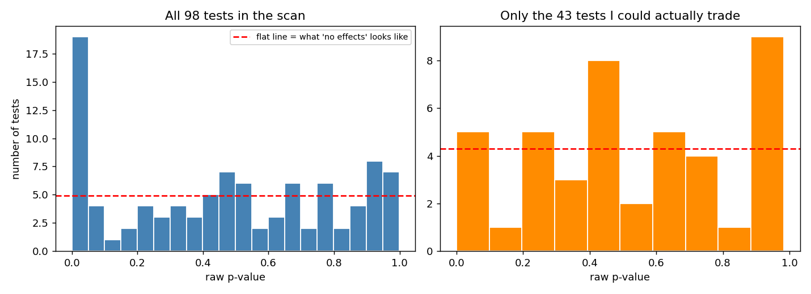
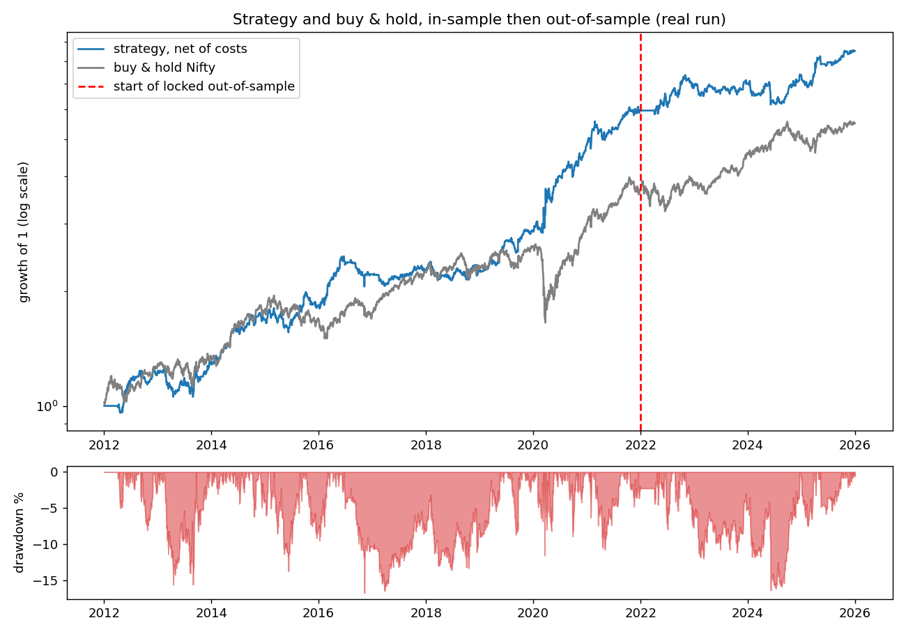

# Overnight gap momentum in Nifty 50: it worked in 2012-2021 and mostly did not hold in 2022-2025

Rishabh Vishwakarma. Technical assessment, Part C. Data: Nifty 50 and Bank Nifty daily bars, Yahoo Finance, Jan 2012 to Dec 2025.

## 1. Bottom line

- I found one effect in the research period that survived multiple-testing correction and could be traded with next-open entry: a big overnight gap on day t predicts the return from the open of t+1 to the open of t+2, so gaps tend to continue.
- I turned it into a simple rule and froze it before touching the locked 2022-2025 data. Out of sample the underlying effect is gone (t-stat 3.9 in research, -0.04 out of sample), the strategy's Sharpe is about the same as buy and hold, and the same rule on Bank Nifty loses money.
- **My recommendation is not to put real money behind this as a standalone strategy.** I would put the chance that a real, tradable edge is still there at about 20%, and I would suggest paper trading it while tracking the stop conditions in section 7.

| | Research 2012-21 | Out of sample 2022-25 | Buy & hold Nifty, out of sample |
|---|---|---|---|
| CAGR | 20.2% | 9.6% | 10.8% |
| Sharpe (net of 0.05% per side) | 1.25 | 0.82 | 0.78 |
| Sharpe before costs | 1.68 | 1.38 | n/a |
| Max drawdown | -16.7% | -16.4% | -17.1% |
| Win rate / avg win / avg loss | 51.9% / 1.55% / -1.07% | 49.1% / 1.30% / -0.96% | n/a |
| Trades | 661 | 263 | n/a |
| Same rule on Bank Nifty, Sharpe | 0.79 | -0.17 | n/a |

- The bootstrap 95% interval for the out-of-sample Sharpe is -0.22 to 1.83, so it cannot be separated from zero or from buy and hold. Sharpe uses a risk-free rate of 0.

## 2. How I kept the out-of-sample set clean

- The plan (split, selection rule, protocol) was written before any data was downloaded (`markdown/PLAN_written_before_looking_at_data.md`). The data was then downloaded in two separate calls and saved in two folders.
- The research code cannot read the locked folder, because it raises an error unless an environment variable is set and only the final script sets it. I never printed, plotted or opened the 2022-2025 file during research.
- Before the final run I fixed the parameters and hashed the code and the locked files (`frozen_rules.json`, 3 Nov 2026, 15:49). The final script checks those hashes and writes a lock file, and it ran once.
- For transparency, I would like to mention four things:
  - I know in general terms that Indian equities rose a lot in 2023-24, but I did not use that to pick anything.
  - Before freezing, I ran the final script in dry-run mode on research data to catch bugs, and it found a memory error that I fixed before the freeze.
  - The Diwali "Muhurat" dates for 2022-2025 in the cleaning code came from public knowledge and not from the data. NSE's circulars later confirmed all of them.
  - After the single run I opened the locked file once more, only to check it against NSE's holiday lists and index files (`outputs/pdf/post_hoc_locked_data_check.pdf`). It found nothing to correct, and I did not rerun the test.

## 3. Data

- The source is Yahoo Finance (tickers ^NSEI and ^NSEBANK), raw daily OHLCV, and the full report is in `outputs/pdf/data_quality_report.pdf`. I compared it with NSE's own daily index files, and the Nifty open and close are identical on all 2,404 days that could be compared.
- **Missing days:** Bank Nifty has 12 dates that Nifty lacks, and six of them are 1 January, when NSE trades. I checked all 12 against NSE's official holiday lists and none is a holiday, so they are real trading days missing from Yahoo's Nifty series. The same check found 3 more real trading days missing from both series (26 Oct 2012, 13 Feb 2019, 29 Mar 2019). NSE's own files have 14 of these 15 days. Putting them back moves the research Sharpe only from 1.25 to 1.23, and the scan and the choice of rule come out the same (`outputs/pdf/nse_filled_side_check.pdf`). I still kept only dates present in both series, so that research and out-of-sample come from one source.
- **Bad print:** Bank Nifty on 10 Nov 2016 is a frozen bar (O=H=L=C, volume 0), and I dropped it.
- **Special sessions:** I dropped three one-hour Diwali Muhurat sessions. The Saturday budget sessions (2015, 2020) are missing from the data, so their moves sit inside the next Monday.
- **Volume:** Yahoo's is empty for Nifty in 2012 and zero on 1,415 of 2,461 Bank Nifty days. NSE's own files have it from 21 Feb 2012, but I do not use volume anywhere.
- **Outliers:** 29 days had a move above 5% in either index (for example Aug 2015, Mar-May 2020, budget and tax-cut days). Both indices moved the same way on each day, so I kept them, as removing them would hide the tail risk.
- The final tables have 2,445 research days and 984 locked days, cleaned with the same function.

## 4. What I tested (Step 2)

- I ran **98 tests** and kept every one in `outputs/tables/anomaly_scan_all_tests.csv`, adjusting for multiple testing across the whole table (Bonferroni and Benjamini-Hochberg).
- Of these, 43 could be traded with next-open entry, and 3 of those had a raw p-value under 0.05, where chance alone would give about 2.

| Family | What I tested | Result |
|---|---|---|
| Volatility clustering | Ljung-Box on squared returns, ARCH-LM | Overwhelming (p near 0), but it is about risk, not direction |
| Fat tails | Jarque-Bera, excess kurtosis | 18.2 (Nifty), 12.5 (Bank Nifty). Not normal |
| Random walk tests | Ljung-Box on returns, variance ratios, runs test | Weak positive autocorrelation in close-to-close returns (p about 0.001); variance ratios p above 0.06 |
| Overnight vs intraday | Mean overnight and intraday return | Overnight +12.6 bps/day, intraday -7.2 bps/day (Nifty), highly significant, but can't be captured with next-open entry |
| **Gaps (tradable)** | Yesterday's gap vs next open-to-open return | **Survives**: Nifty p = 0.0001 (BH 0.0008, Bonferroni 0.009), Bank Nifty BH 0.016 |
| Day of week | 24 tests | No effect found. Best raw p = 0.045 (Monday), BH 0.23 |
| Expiry week / day, turn of month | 16 tests | No effect found. Best raw p = 0.26 |
| Streaks | 2-4 up/down closes, 12 tests | No effect found. Best raw p = 0.068 |
| Nifty vs Bank Nifty | ADF, Engle-Granger, relative-return reversal, lead-lag | No effect found. Ratio not stationary (ADF p = 0.17), not cointegrated (p = 0.83) |
| ML: regimes | Gaussian mixture on volatility and return | No difference in next-day returns by regime (p above 0.89) |
| ML: outliers | Isolation forest (49 days flagged, 65% of them in 2020) | No effect after outlier days (p above 0.46) |
| ML: direction | Walk-forward logistic and gradient boosting, 2016-2021 | Logistic 54.6% vs 54.6% baseline (Nifty); boosting 51.4% vs 54.6%. No skill |

- The gap result held up under the checks I could think of: winsorising at 1%/99% (t about 4), dropping 2020 (t 3.3 for Nifty and 2.3 for Bank Nifty), rank correlation (p < 0.0001), a monotonic quintile pattern, and a positive sign in 9 of 10 years (but about zero in 2017-2019).
- The same rule driven by close-to-close or intraday returns, or by shuffled gaps, loses money. Details are in `outputs/pdf/gap_diagnostics.pdf` and `outputs/pdf/mechanism_checks.pdf`.

## 5. Hypothesis (Step 3): who is on the other side

- This is the reasoning I had when I froze the rule, but it is written up after the out-of-sample run (only the plan file was written beforehand), so please treat it as an explanation that fits and not as a pre-registered claim.
- **Idea:** the overnight gap carries news that arrived while India was shut (US close, Asia, GIFT Nifty). Foreign institutions are the marginal price setters in Nifty and they split big orders over several days to limit their impact, so a large gap up suggests more buying in the next day or two.
- **Likely counterparties:** domestic retail and intraday traders who fade gaps ("gap fill"), and liquidity providers who are slow to move their quotes.
- **Why it may not be arbitraged away:** the effect is small against costs (the best bucket earned about 25 bps against a 10 bps round-trip cost), it is lumpy, and most of the money came in volatile periods that put people off.
- I have no direct evidence for this story, as I have no flow data. The alternatives I could not rule out are:
  - Chance, since this was the best of about 100 tests.
  - A quirk of the 2012-2021 sample, in which overnight returns were very positive and intraday returns negative.
  - Opening-price effects, since entering at the next close instead of the next open cuts the in-sample Sharpe from 1.25 to 0.39.
- The out-of-sample result points toward the first two.

## 6. Strategy (Step 4) and validation (Step 5)

**Rule (Nifty 50, fully specified)**

1. At the close of day t, compute the overnight gap (open of day t against close of day t-1).
2. Divide it by the standard deviation of the previous 60 daily gaps (not including today's) and call this z.
3. If z is at least +0.5, go long, and if z is at most -0.5, go short. A signal stays alive for 2 days.
4. Enter at the **open of day t+1**, and exit at the open two days later or flip if the signal changes.
5. Size is 100% of capital with no leverage and no volatility scaling, and costs are 0.05% per side on every change in position (a flip is two sides).

**How the variant was chosen**

- I tested a fixed grid of 18 variants (threshold 0.5/1.0/1.5, hold 1/2/3 days, long-short or long only). The selection rule was written first: the highest net Sharpe among variants with at least 100 trades and a positive net Sharpe in both halves, and every variant passed that filter.
- White's reality check across all 18 gave p = 0.003, so the best one is not just the luckiest of the grid.
- The code tests (`code/test_engine.py`) confirm that signals do not change when the future is deleted or scrambled, that cost and return accounting matches hand calculations, and that random positions lose money after costs.

**Research period**

- The net Sharpe is 1.25, CAGR 20.2% and max drawdown -16.7%, against 0.85, 14.4% and -37.8% for buy and hold.
- The rule is on average only 37% net long (beta 0.33), with an alpha of 14.7% a year (t = 3.0).
- Costs matter: the Sharpe falls from 1.68 to 1.25 at 0.05% per side, and to 0.81 at 0.10%.

**Parameter sensitivity (research)**

- I moved the threshold and window by +/-20% and the hold by one day, one at a time and in all eight corners together. Net Sharpe stayed between 0.73 and 1.32, positive in all 15 variants.
- Out of sample the same variants ranged from -0.21 (hold 1 day) to 0.82. Nothing was re-tuned from that, but it shows the research-period robustness was optimistic.

**Drawdown to expect**

- A stationary bootstrap of the research returns (10,000 paths of 4 years) gives a median max drawdown of -14.9% and a worst 5% of -24.6% if the edge is as measured.
- If half the edge is overfit, the median is -19.8%, the worst 5% is -34.2% and there is a 9% chance of a non-positive 4-year Sharpe. I would plan around this second scenario.
- The actual out-of-sample drawdown was -16.4%, inside both.

**Out of sample**

- The strategy returned 16.4%, 1.0%, 4.9% and 16.1% in 2022-2025, against 4.2%, 19.8%, 8.8% and 9.9% for buy and hold, with an average exposure of only 20% and a beta of 0.05.
- Alpha was 9.3% a year, but with t = 1.37 it is not significant. Costs cut the CAGR from 17.3% (gross) to 9.6% (net), about 45% of the gross return.
- The gap effect is about zero (Nifty -0.2 bps per standard deviation, against +12.8 in research), the quintile pattern is no longer monotonic, and the same rule on Bank Nifty had a Sharpe of -0.17.

## 7. Verdict (Step 6)

- My recommendation is not to trade this with real money. The research result looked strong (net Sharpe 1.25, reality-check p of 0.003, stable under +/-20% parameter changes), but out of sample the Sharpe of 0.82 is no better than buy and hold at 0.78, its interval includes zero, the regression effect that motivated the idea has vanished, and it fails on the sister index.
- It is also fragile. Costs take about 45% of the gross return, and the edge nearly disappears if I cannot trade close to the opening print (Sharpe 0.39 when entering at the close). My confidence in a real, tradable edge is about 20%.
- I would stop (or not start) if any of these happens:
  - A rolling 250-day estimate of the gap effect has a negative t-stat.
  - Net Sharpe over 12 months is below zero.
  - The drawdown goes past -25%.
  - Realised costs are above 0.08% per side, where the Sharpe falls to about 0.5 before anything else goes wrong.
  - The exchange changes its opening mechanism.

## 8. Limits and things I would do differently

- Yahoo data is not the exchange file. I checked it against NSE's holiday lists and daily index files for 2012-2021, and 15 real trading days are missing from it. The 2013 and 2014 holiday lists come from a broker's copy, but NSE's own files do not contradict them. 33 Nifty bars before NSE's files start (21 Feb 2012), and 12 later days its archive lacks, could not be checked. The same checks on the locked data, made after the single out-of-sample run, found nothing to change.
- The out-of-sample run started the 60-day volatility window on the first day of 2022, so the first ~60 trading days of 2022 had no signal (the flat line in the chart). This is a limitation of how I set up the test. It does not flatter the result, but some early-2022 trades are missing, and I did not rerun, to keep to the plan of a single look at the locked data.
- Open prices are index values at 9:15 and cannot be traded exactly, so 0.05% per side may be too low for the first minutes of the session. This is one of the main risks to the result.
- Sharpe uses a risk-free rate of 0, and returns are not adjusted for the extra volatility of a Monday or post-holiday day.
- The grid and the 98 tests are all the searching I did, and all of it is counted. Nifty and Bank Nifty tests are strongly correlated, so Bonferroni is conservative.
- Kaggle GPU was not used, because the data is about 2,500 rows per index and every model is small, so the whole project runs in a few minutes on a laptop CPU.
- Code and outputs are described in `README.md`, and everything here can be regenerated from `code/` (the final out-of-sample step is designed to run only once).

Thank you for the opportunity to work on this assessment. I would be glad to walk through any part of it in the follow-up round.
