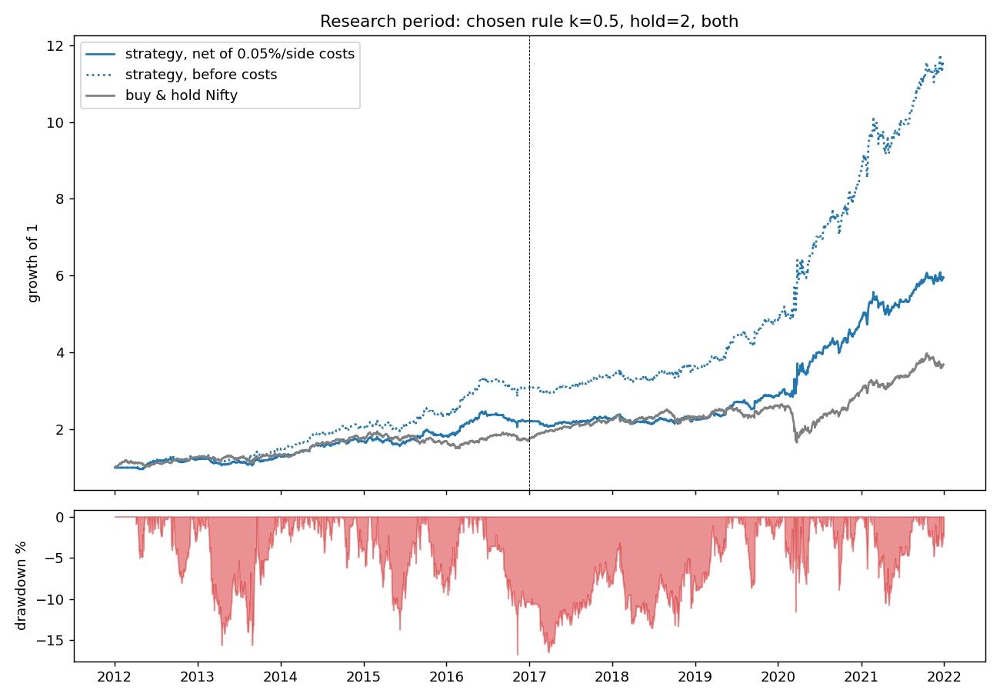
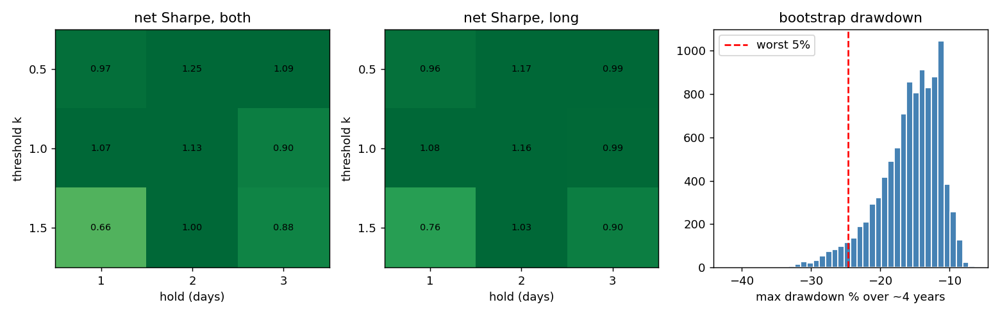

# Strategy research (research period 2012-2021 only)

## 1. The grid I tried (every variant, nothing hidden)

|   k |   hold | side   |   gross Sharpe |   net Sharpe |   Sharpe 12-16 |   Sharpe 17-21 |   CAGR % |   MaxDD % |   trades |   time in market % |
|----:|-------:|:-------|---------------:|-------------:|---------------:|---------------:|---------:|----------:|---------:|-------------------:|
| 0.5 |      1 | both   |           1.62 |         0.97 |           1.16 |           0.82 |    13.05 |    -14.95 |      860 |              54.91 |
| 0.5 |      1 | long   |           1.47 |         0.96 |           1.19 |           0.78 |    10.58 |    -18.72 |      563 |              39.73 |
| 0.5 |      2 | both   |           1.68 |         1.25 |           1.21 |           1.28 |    20.19 |    -16.74 |      661 |              77.7  |
| 0.5 |      2 | long   |           1.47 |         1.17 |           1.19 |           1.16 |    15.76 |    -19.67 |      385 |              57.16 |
| 0.5 |      3 | both   |           1.44 |         1.09 |           1.11 |           1.07 |    18.13 |    -23.32 |      578 |              88.13 |
| 0.5 |      3 | long   |           1.23 |         0.99 |           0.97 |           1.02 |    13.85 |    -20.18 |      318 |              64.98 |
| 1   |      1 | both   |           1.58 |         1.07 |           1.21 |           0.98 |    10.93 |    -15.48 |      511 |              26.35 |
| 1   |      1 | long   |           1.52 |         1.08 |           1.03 |           1.13 |     8.48 |     -8.8  |      340 |              18.29 |
| 1   |      2 | both   |           1.47 |         1.13 |           1.01 |           1.24 |    14.82 |     -9.55 |      430 |              43.78 |
| 1   |      2 | long   |           1.44 |         1.16 |           1.1  |           1.22 |    11.71 |     -8.93 |      273 |              30.69 |
| 1   |      3 | both   |           1.17 |         0.9  |           0.94 |           0.87 |    12.53 |    -14.07 |      381 |              55.77 |
| 1   |      3 | long   |           1.2  |         0.99 |           1.21 |           0.83 |    11.04 |    -10.43 |      233 |              39.4  |
| 1.5 |      1 | both   |           1.01 |         0.66 |           0.74 |           0.62 |     4.93 |    -13.71 |      269 |              12.36 |
| 1.5 |      1 | long   |           1.04 |         0.76 |           0.57 |           0.91 |     4.43 |     -6.78 |      167 |               7.82 |
| 1.5 |      2 | both   |           1.23 |         1    |           0.98 |           1.03 |    10.5  |    -12.91 |      244 |              21.89 |
| 1.5 |      2 | long   |           1.22 |         1.03 |           1.19 |           0.9  |     7.63 |     -9.72 |      147 |              14.12 |
| 1.5 |      3 | both   |           1.07 |         0.88 |           1.08 |           0.75 |     9.92 |    -16.08 |      223 |              29.87 |
| 1.5 |      3 | long   |           1.06 |         0.9  |           1.16 |           0.72 |     7.52 |    -11.39 |      132 |              19.31 |

Variants passing the rule (>= 100 trades, positive net Sharpe in both halves): 18 of 18
**Chosen: k=0.5, hold=2 day(s), side=both, window=60**

## 2. Did I just pick the luckiest of 18 variants? (White's Reality Check)

Bootstrap p-value that the best of the 18 variants is no better than zero-edge luck: **0.003**
(small = the best variant is hard to explain by selection luck alone)

## 3. Chosen rule, research period

|                |   Strategy (net of costs) |   Strategy 2012-16 |   Strategy 2017-21 |   Buy & hold Nifty (open to open) |
|:---------------|--------------------------:|-------------------:|-------------------:|----------------------------------:|
| CAGR %         |                     20.19 |              17.89 |              22.5  |                             14.4  |
| Ann vol %      |                     15.76 |              14.43 |              16.98 |                             17.64 |
| Sharpe         |                      1.25 |               1.21 |               1.28 |                              0.85 |
| Max drawdown % |                    -16.74 |             -16.74 |             -11.57 |                            -37.77 |
| Days           |                   2444    |            1216    |            1228    |                           2444    |
| Trades         |                    661    |             333    |             328    |                            nan    |
| Win rate %     |                     51.89 |              51.05 |              52.74 |                            nan    |
| Avg win %      |                      1.55 |               1.53 |               1.57 |                            nan    |
| Avg loss %     |                     -1.07 |              -1.08 |              -1.07 |                            nan    |

Gross Sharpe (before costs): 1.68. Total costs paid over the period: 66.1% of capital (simple sum of daily costs).
Time in the market: 78% of days. Average trade: 0.29% net.

Net return by calendar year (%):
|              |   2012 |   2013 |   2014 |   2015 |   2016 |   2017 |   2018 |   2019 |   2020 |   2021 |
|:-------------|-------:|-------:|-------:|-------:|-------:|-------:|-------:|-------:|-------:|-------:|
| net return % |   22.5 |    6.6 |   28.9 |    8.9 |   20.7 |    2.4 |    0.7 |   25.7 |   68.5 |   23.1 |

Gross P&L split: long side 189.0% of capital, short side 67.5% of capital (sum of daily gross, no compounding).
Net Sharpe excluding 2020: 1.13 (full period 1.25)

Same rule, same parameters on **Bank Nifty** (no re-tuning): net Sharpe 0.79, CAGR 16.7%, max DD -26.7%, 687 trades.

The chart shows the growth of 1 for the chosen rule after costs (solid) and before costs (dotted) against buy and hold, with the drawdown of the rule underneath. The thin vertical line at the start of 2017 separates the two halves used for the half-period Sharpe columns above.

## 4. How much do costs matter?

|   cost per side % |   net Sharpe |   CAGR % |
|------------------:|-------------:|---------:|
|              0    |         1.68 |    28.65 |
|              0.02 |         1.46 |    24.35 |
|              0.05 |         1.25 |    20.19 |
|              0.08 |         1.03 |    16.16 |
|              0.1  |         0.81 |    12.27 |

## 5. Parameter sensitivity (each parameter moved by -20% / +20%)

Hold days is an integer so I moved it by one day (h-1, h+1); with a 1-3 day hold, 20% is less than a day. The window is rounded to whole days.

| variant                |   k |   window |   hold |   net Sharpe |   CAGR % |   MaxDD % |   trades |
|:-----------------------|----:|---------:|-------:|-------------:|---------:|----------:|---------:|
| base                   | 0.5 |       60 |      2 |         1.25 |    20.19 |    -16.74 |      661 |
| k -20%                 | 0.4 |       60 |      2 |         0.99 |    16.01 |    -19.38 |      716 |
| k +20%                 | 0.6 |       60 |      2 |         1.23 |    19.34 |    -18.6  |      615 |
| window -20%            | 0.5 |       48 |      2 |         1.15 |    18.56 |    -17.27 |      672 |
| window +20%            | 0.5 |       72 |      2 |         1.32 |    21.67 |    -16.27 |      654 |
| hold -1                | 0.5 |       60 |      1 |         0.97 |    13.05 |    -14.95 |      860 |
| hold +1                | 0.5 |       60 |      3 |         1.09 |    18.13 |    -23.32 |      578 |
| corner k-20% w-20% h-1 | 0.4 |       48 |      1 |         0.73 |    10.04 |    -16.47 |      936 |
| corner k-20% w-20% h+1 | 0.4 |       48 |      3 |         0.91 |    15.16 |    -25.34 |      653 |
| corner k-20% w+20% h-1 | 0.4 |       72 |      1 |         0.87 |    12.17 |    -13.65 |      909 |
| corner k-20% w+20% h+1 | 0.4 |       72 |      3 |         1    |    16.62 |    -25.24 |      637 |
| corner k+20% w-20% h-1 | 0.6 |       48 |      1 |         0.95 |    12.34 |    -14.47 |      787 |
| corner k+20% w-20% h+1 | 0.6 |       48 |      3 |         1.05 |    17.23 |    -22.98 |      537 |
| corner k+20% w+20% h-1 | 0.6 |       72 |      1 |         0.96 |    12.41 |    -15.48 |      755 |
| corner k+20% w+20% h+1 | 0.6 |       72 |      3 |         1.01 |    16.26 |    -26.42 |      521 |

Net Sharpe is positive in 100% of these 15 variants. Range: 0.73 to 1.32.

## 6. Drawdown I should realistically expect (stationary bootstrap, 10,000 paths)

Over a 1000-day (~4 year) horizon, resampling this strategy's own daily net returns.

**Scenario 1: the edge is exactly what I measured in the research period**

|                     |   max drawdown % |   annualised return % |   Sharpe |
|:--------------------|-----------------:|----------------------:|---------:|
| typical (median)    |            -14.9 |                  20   |      1.3 |
| bad (worst 25%)     |            -18.1 |                  14.4 |      1   |
| worse (worst 10%)   |            -21.9 |                   9.5 |      0.7 |
| very bad (worst 5%) |            -24.6 |                   6.7 |      0.5 |
| extreme (worst 1%)  |            -29.6 |                   1.9 |      0.2 |

P(4-year max drawdown worse than 10%) = 96%, worse than 15% = 50%, worse than 20% = 16%, worse than 25% = 4%. P(4-year Sharpe <= 0) = 0.2%.

**Scenario 2: only half of the measured edge is real (daily mean return cut by 50%)**

|                     |   max drawdown % |   annualised return % |   Sharpe |
|:--------------------|-----------------:|----------------------:|---------:|
| typical (median)    |            -19.8 |                   8.8 |      0.6 |
| bad (worst 25%)     |            -24.8 |                   3.7 |      0.3 |
| worse (worst 10%)   |            -30.6 |                  -0.7 |      0   |
| very bad (worst 5%) |            -34.2 |                  -3.3 |     -0.2 |
| extreme (worst 1%)  |            -40.9 |                  -7.6 |     -0.5 |

P(4-year max drawdown worse than 10%) = 99%, worse than 15% = 81%, worse than 20% = 49%, worse than 25% = 24%. P(4-year Sharpe <= 0) = 9.2%.

Historical max drawdown of the rule in the research period: -16.7%.

Caveat: the bootstrap only captures sampling noise. It cannot see regime change or the selection bias of picking this rule out of many ideas, so scenario 2 is the one i would plan around.

Left and middle: net Sharpe of the 18 variants of the grid, trading both sides and long only (threshold k down, holding days across). Right: the bootstrap distribution of the worst drawdown over about four years, with the worst 5% of paths marked.

## 7. How much is just market exposure?

Average net exposure 0.37 of capital. Beta to always-long Nifty 0.33 (t=4.6). Alpha 14.7% a year (t=3.02).

